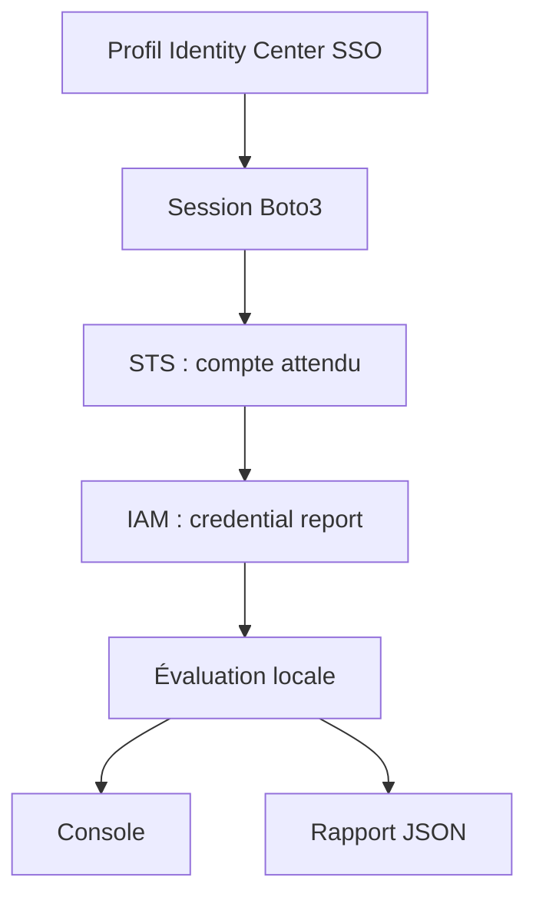

# AWS IAM Security Auditor

Première version réelle du projet Python/Boto3. Aucun résultat AWS réel n'a encore été collecté.

## Périmètre actuel

STS vérifie le compte attendu. Un profil SSO explicite est obligatoire. Collecte du credential report puis contrôles root MFA, clés root actives, MFA des utilisateurs console, âge des clés actives et activité observée. Console et JSON horodaté UTC. Aucune modification des identités, clés ou permissions. GenerateCredentialReport crée ou actualise uniquement le rapport AWS.

## Installation et connexion (PowerShell)

Installer AWS CLI v2 selon https://docs.aws.amazon.com/cli/latest/userguide/getting-started-install.html puis ouvrir un nouveau terminal.

```powershell
python -m venv .venv
.\.venv\Scripts\python.exe -m pip install -r requirements.txt
aws configure sso --profile iam-audit
aws sso login --profile iam-audit
aws sts get-caller-identity --profile iam-audit
.\.venv\Scripts\python.exe auditor.py --profile iam-audit --expected-account 123456789012
```

Remplacer le numéro d'exemple par votre compte lab. Utiliser un permission set d'audit dédié : audit-policy.json contient les permissions de collecte de cette V1. Sa configuration dans AWS reste manuelle. Ne pas communiquer de secret ni utiliser le root.

```powershell
python -m unittest discover -s tests -v
```

Codes de sortie : 0 = collecte complète sans FAIL ; 1 = FAIL ; 2 = collecte incomplète/erreur. WARN reste visible dans le rapport même avec code 0.

## Limites connues

- Le rapport peut dater de quatre heures ; son horodatage est enregistré.
- Les flags root établissent la présence de clés actives, pas l'absence de clés inactives.
- Un root centralisé sans credentials exige une analyse contextuelle du résultat MFA.
- L'activité observée dans le rapport ne couvre pas toute l'activité de l'identité ; ne pas supprimer un compte sur cette seule base.
- Les clés inactives ne sont pas inventoriées, les clés ne sont pas identifiées par ID et les credentials spécifiques à un service ne sont pas couverts.
- Cette V1 ne couvre pas Identity Center, policies/groupes, privilèges effectifs ou EC2.
- Les rapports contiennent des métadonnées sensibles ; reports/ est exclu de Git.
- Tests locaux sur fixtures, aucune validation AWS réelle pour le moment.

## Prochaines étapes

ListUsers/ListAccessKeys/GetAccessKeyLastUsed avec pagination ; groupes et policies directes/inline ; détection AdministratorAccess et review des wildcards ; EC2 par régions explicites avec résolution du rôle du profile ; tests botocore Stubber des erreurs et de la pagination. Refactoriser lorsque cette collecte fonctionne sur le lab.

## Architecture



## Références APIs

- https://docs.aws.amazon.com/boto3/latest/guide/credentials.html
- https://docs.aws.amazon.com/boto3/latest/reference/services/sts/client/get_caller_identity.html
- https://docs.aws.amazon.com/boto3/latest/reference/services/iam/client/generate_credential_report.html
- https://docs.aws.amazon.com/boto3/latest/reference/services/iam/client/get_credential_report.html
- https://docs.aws.amazon.com/IAM/latest/UserGuide/id_credentials_getting-report.html
