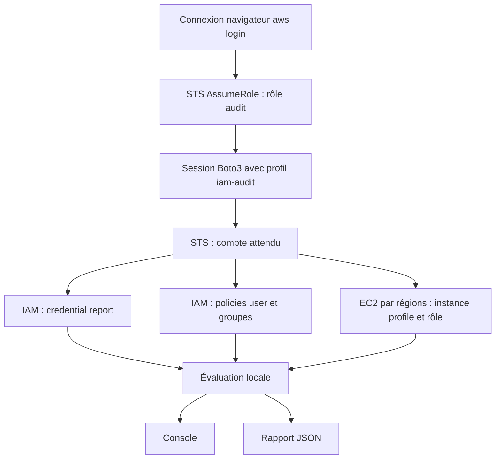

# AWS IAM Security Auditor

Auditeur de sécurité AWS IAM en Python/Boto3. Les audits réels des credentials, permissions et rôles EC2 sont validés sur le lab. Une policy AdministratorAccess attachée directement à un développeur a été détectée, retirée manuellement et son absence confirmée par re-test. CloudTrail a documenté l'attribution et le retrait. DeveloperPolicy et AuditorPolicy ont été validées avec Access Analyzer sans findings. L'inventaire détaillé des clés a été exécuté sur le lab : aucun des six IAM Users ne possède de clé active ou inactive ; collecte complète. Les cas avec clés et les erreurs restent validés par tests locaux.

Python 3.10+ ; AWS CLI v2 ; Boto3. Console + JSON, 30 tests locaux, aucun besoin d'organisation AWS. Usage lab/portfolio ; ne pas interpréter les contrôles comme une certification du moindre privilège.

## Contrôles

| ID | Objet | Source |
|---|---|---|
| IAM-001 | MFA root | Credential report |
| IAM-002 | Clés root actives observées | Credential report |
| IAM-003 | MFA des utilisateurs console | Credential report |
| IAM-004 | Clés utilisateur actives/inactives, âge et dernière utilisation | ListUsers, ListAccessKeys, GetAccessKeyLastUsed |
| IAM-005 | Inactivité observée, délai de grâce | Credential report |
| IAM-006 | AdministratorAccess chez les développeurs et patterns administrateur | Policies user/group |
| IAM-007 | Policies directes | Policies user |
| IAM-008 | Groupes, utilisateurs sans groupe | ListGroupsForUser |
| IAM-009 | Instance profile et rôle EC2 | DescribeInstances, GetInstanceProfile |
| IAM-010 | Allow avec wildcard/inverse matching à examiner | Documents des policies |

Seuils configurables : --inactivity-days 90, --key-age-days 90, --grace-days 30. Les WARN de wildcards nécessitent une revue : certaines actions requièrent Resource "*". CloudTrail et Access Analyzer sont exploités séparément via AWS CLI ; voir docs/REVIEW.md.

## Périmètre actuel

STS vérifie le compte et le rôle attendus avant la collecte. Un profil explicite avec credentials temporaires (AssumeRole ou SSO) est obligatoire ; une connexion directe en IAM User est refusée. Collecte du credential report puis contrôles root MFA, clés root actives, MFA des utilisateurs console, âge des clés actives et activité observée. Console et JSON horodaté UTC. Aucune modification des identités, clés ou permissions. GenerateCredentialReport crée ou actualise uniquement le rapport AWS.

## Installation et connexion (PowerShell)

Installer AWS CLI v2 selon https://docs.aws.amazon.com/cli/latest/userguide/getting-started-install.html puis ouvrir un nouveau terminal.

```powershell
python -m venv .venv
.\.venv\Scripts\python.exe -m pip install -r requirements.txt
aws login --profile lab-login --region eu-north-1
aws configure set role_arn arn:aws:iam::123456789012:role/IAMSecurityAuditRole --profile iam-audit
aws configure set source_profile lab-login --profile iam-audit
aws configure set region eu-north-1 --profile iam-audit
aws sts get-caller-identity --profile iam-audit
.\.venv\Scripts\python.exe auditor.py --profile iam-audit --expected-account 123456789012
```

Remplacer le numéro d'exemple par votre compte lab. Créer manuellement IAMSecurityAuditRole avec une trust policy autorisant l'utilisateur de connexion et les permissions de audit-policy.json. L'utilisateur source doit pouvoir assumer ce rôle et utiliser aws login (SignInLocalDevelopmentAccess). AWS CLI >= 2.32 est nécessaire. Boto3 requiert CRT pour aws login, installé via boto3[crt]. Aucune organisation, instance Identity Center ou clé KMS n'est nécessaire pour ce parcours. Ne pas communiquer de secret ni utiliser le root. Renouveler la connexion expirée avec aws login --profile lab-login.

```powershell
python -m unittest discover -s tests -v
```

Codes de sortie : 0 = collecte complète sans FAIL ; 1 = FAIL ; 2 = collecte incomplète/erreur. WARN reste visible dans le rapport même avec code 0.

## Rôles EC2 — IAM-009

```powershell
.\.venv\Scripts\python.exe auditor.py --profile iam-audit --expected-account 123456789012 --ec2-regions eu-north-1 --output reports/audit-with-ec2.json
```

Remplacer le compte d'exemple. --ec2-regions accepte plusieurs régions explicites. Aucune découverte automatique de toutes les régions n'est effectuée. Sans cet argument, EC2 est SKIP et n'est pas couvert par complete=True. Avec cet argument, DescribeInstances est paginé puis GetInstanceProfile résout les rôles réels, même si leur nom diffère de celui du profil. PASS = rôle présent, WARN = pas de profil ou profil sans rôle, ERROR = lecture impossible. Aucune instance n'est modifiée. Les instances arrêtées sont incluses, celles terminées exclues. Une région vide produit INFO. Les erreurs régionales/profils rendent la collecte incomplète, même si d'autres régions réussissent.

La présence d'un rôle ne prouve ni le moindre privilège ni l'utilisation de ses credentials par l'application. Le contrôle ne teste pas les accès S3, IMDS ou les policies du rôle. L'absence de rôle demande une revue du besoin d'accès AWS, pas une conclusion automatique de vulnérabilité.

## Limites connues

- Le rapport peut dater de quatre heures ; son horodatage est enregistré.
- Les flags root établissent la présence de clés actives, pas l'absence de clés inactives.
- Un root centralisé sans credentials exige une analyse contextuelle du résultat MFA.
- L'activité observée dans le rapport ne couvre pas toute l'activité de l'identité ; ne pas supprimer un compte sur cette seule base.
- Les clés utilisateur actives et inactives sont inventoriées ; seule la fin de leur identifiant est conservée (référence pouvant ne pas être unique). Aucun secret de clé n'est récupéré. Les credentials spécifiques à un service ne sont pas couverts. Une absence de dernière utilisation ne prouve pas « jamais utilisée ». Les données d'inactivité IAM-005 restent celles du credential report, sans fusion avec cette collecte plus récente.
- Inventaire des policies user/group managées et inline ajouté avec pagination et origine des permissions. IAM-006 signale AdministratorAccess pour les développeurs (nom commençant par developer ou groupe Developers configurable via --developers-group). IAM-007 inventorie les grants directs ; IAM-008 présente les groupes et signale leur absence ; IAM-010 signale les Allow avec wildcards, NotAction ou NotResource pour revue.
- Les noms attendus des groupes auditor/security ne sont pas encore validés automatiquement. Une absence de pattern administrateur observé n'établit pas le moindre privilège.
- Les boundaries, SCPs, resource policies, sessions et rôles assumables ne sont pas évalués ; aucune conclusion complète sur les permissions effectives. Les conditions et refus peuvent restreindre les grants signalés.
- EC2 est intégré sur les régions explicitement choisies. CloudTrail et Access Analyzer ont été utilisés séparément avec AWS CLI, sans intégration automatique au script.
- Les rapports contiennent des métadonnées sensibles ; reports/ est exclu de Git.
- 30 tests locaux : détection, erreurs, pagination SDK IAM/EC2/keys et remédiation assistée. IAM, EC2 et la collecte des clés (six utilisateurs sans clé) sont validés sur le lab ; la remédiation MFA attend sa validation réelle. La CI GitHub est configurée pour Python 3.10 et 3.13 ; elle n'a pas encore été exécutée sur GitHub.

## Prochaines étapes

Un module séparé de remédiation MFA assistée est disponible : voir MFA-REMEDIATION.md. Son pilote est limité à auditor01 et utilise un rôle distinct. Le programme auditor.py conserve son périmètre read-only.

Audit final exécuté avec complete=True : IAM-004 PASS pour les six utilisateurs, IAM-006 PASS pour developer02 et IAM-009 PASS pour le rôle EC2. Les cinq findings MFA restent ouverts. Publication GitHub et CI à confirmer. docs/REVIEW.md rassemble les preuves et limites ; docs/INTERVIEW.md fournit le descriptif CV et entretien. examples/audit-observed-summary.json est un extrait anonymisé de l'audit final observé ; il ne représente pas un environnement sans risque.

## Architecture



## Références APIs

- https://docs.aws.amazon.com/boto3/latest/guide/credentials.html
- https://docs.aws.amazon.com/boto3/latest/reference/services/sts/client/get_caller_identity.html
- https://docs.aws.amazon.com/boto3/latest/reference/services/iam/client/generate_credential_report.html
- https://docs.aws.amazon.com/boto3/latest/reference/services/iam/client/get_credential_report.html
- https://docs.aws.amazon.com/IAM/latest/UserGuide/id_credentials_getting-report.html
- https://docs.aws.amazon.com/boto3/latest/reference/services/ec2/client/describe_instances.html
- https://docs.aws.amazon.com/boto3/latest/reference/services/iam/client/get_instance_profile.html
- https://docs.aws.amazon.com/boto3/latest/reference/services/iam/client/list_access_keys.html
- https://docs.aws.amazon.com/boto3/latest/reference/services/iam/client/get_access_key_last_used.html
